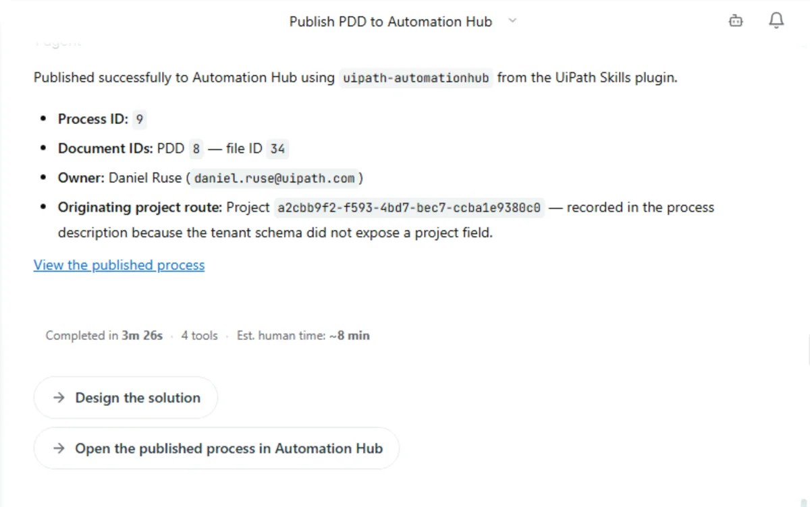

# Design the solution with Cartographer

!!! info "Before you begin: prerequisites"
    Have these ready **before** you start:

    - **The first exercise, finished:** your Cobalt Ridge project, with the PDD published to Automation Hub.
    - **A coding agent:** this guide uses [**Claude Code**](https://docs.claude.com/en/docs/claude-code/overview).
    - **Node.js:** needed to install the **`uip` CLI**.
    - **Access to the workshop environment:** in this workshop we use `{{ training_url }}/{{ training_tenant }}`. Talk to your trainer if you haven't received an invitation.

## 1. Ask Cartographer to design the solution

Go back to your Cobalt Ridge project in Cartographer. When you published the PDD, the confirmation offered a **Design the solution** follow-up. Click it.

{ .screenshot width="700" }

If you don't see the follow-up any more, ask for it directly:

```text
Design the solution for this process and generate the Solution Design Document (SDD).
```

Cartographer turns the TO-BE into a solution architecture on the UiPath Platform. Your future state is a case, so expect the SDD to be built around **Maestro** case orchestration, with the AI agents, human-in-the-loop tasks and integrations your design calls for.

!!! note "Give it time"
    This is a big pass. Expect the SDD to take around 20 minutes. When it finishes, the agent also estimates how much manual effort the same work would have taken.

## 2. Review the SDD and mark it as reviewed

1. Open **Solution design (SDD)** in the left navigation. Walk the table of contents: process overview, diagram, activities, gateways and events, data objects, integrated components, error handling, triggers, project structure, testing strategy and next steps.
2. Read the summary in the conversation. It lists the status, the template validation result, the architecture, what the SDD covers, the result of an independent review, and any open items. Open items are tagged **[SME REVIEW]** so you know exactly what still needs a human answer.
3. Cartographer deliberately leaves the build hand-off open until you approve the design. Mark the SDD as **reviewed** in the document panel.
4. Click **Download** to save the SDD as a Word document.

!!! tip "Why this matters"
    The build never starts from an unreviewed design. A person signs off on the SDD before any coding agent touches it.

<div class="next-page" markdown>
[Next: Build it with a coding agent](build-with-a-coding-agent.md){ .md-button .md-button--primary }
</div>
