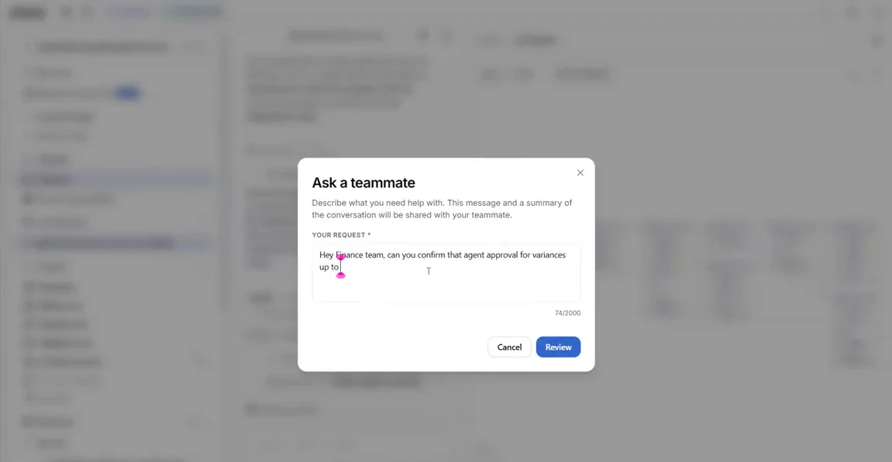
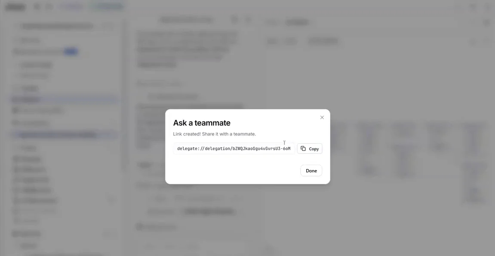

# Optional: ask a teammate

Only run this if you're ahead of the clock. Pair up, so someone is there to answer.

Is 25% the right variance threshold? Instead of guessing, delegate the question to finance from inside the conversation.

1. Use **Ask a teammate** to write your question.

    { .screenshot width="900" }

2. Generate the shareable link and send it to your partner.

    { .screenshot width="900" }

The link opens a session for your colleague with the question and its context already loaded. Their answer lands back in your conversation, ready for you to accept.

!!! tip "Training Environment"
    Log in at **[{{ training_url }}]({{ training_url }})** and remember using tenant **{{ training_tenant }}** for this exercise.

[Next: From Process to Production](../process-to-production/index.md){ .md-button .md-button--primary }

