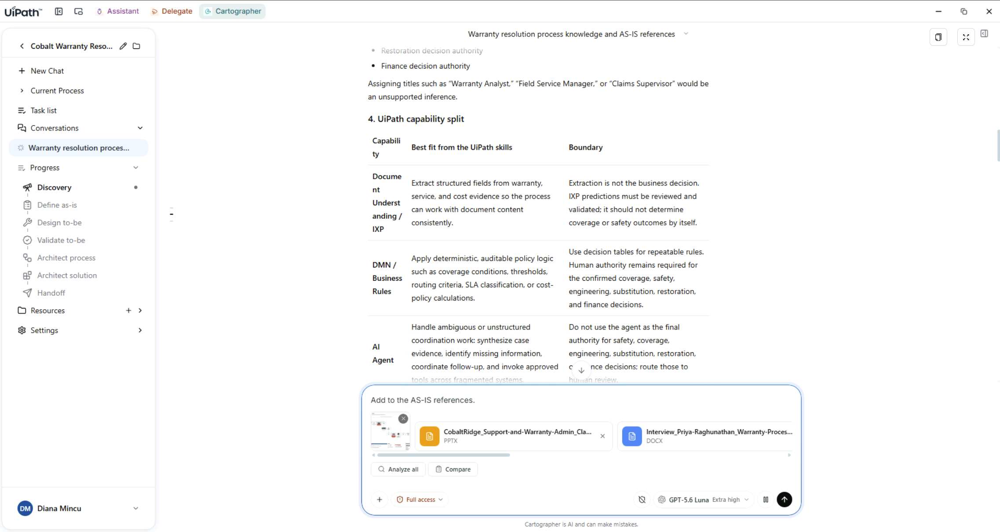
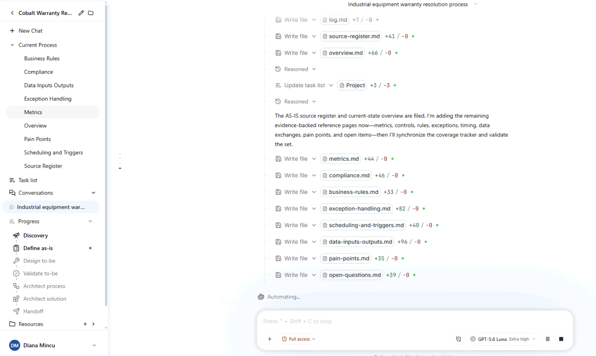
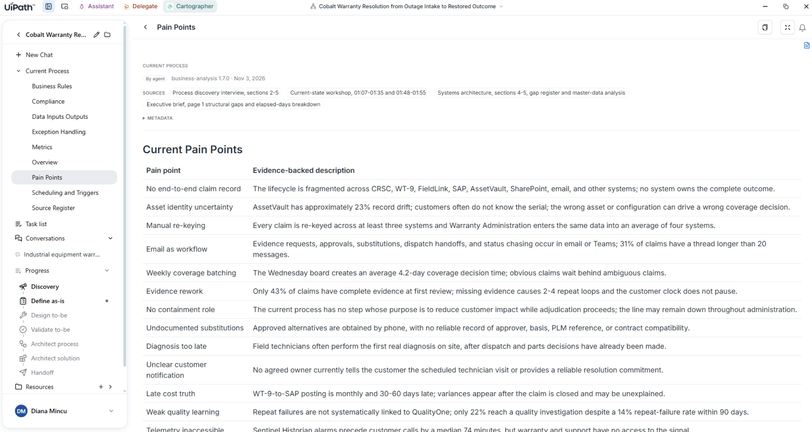
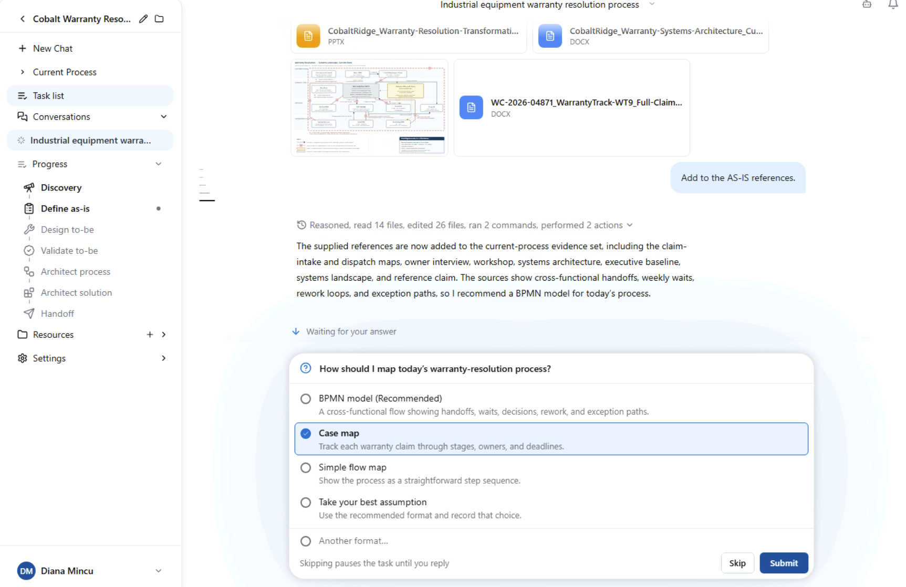
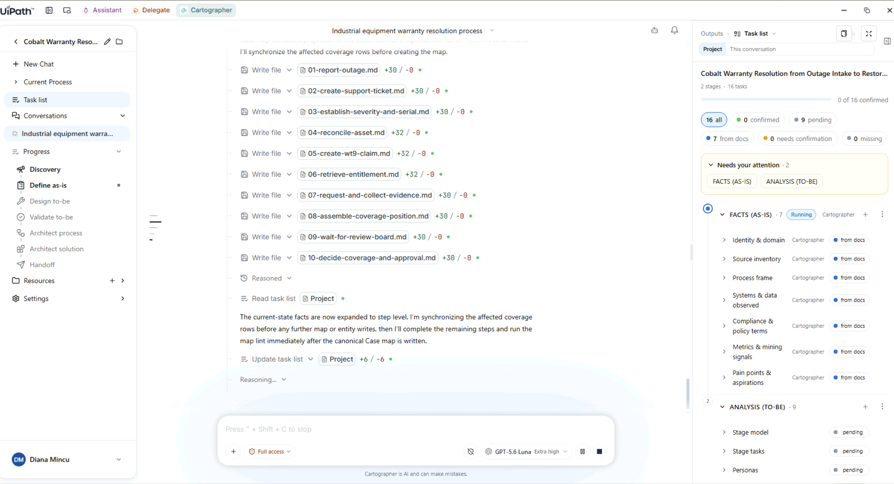
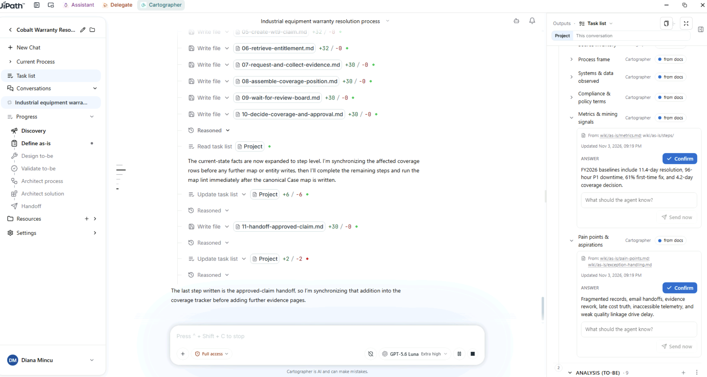

# Capture and review the AS-IS

## 1. Add the evidence

The evidence pack is the kind of material a team already has: process flows from two departments, a process-owner interview, a workshop transcript, an executive brief, a systems architecture draft and a printed claim record.

1. Download the evidence pack and unzip it anywhere on the machine you're working on, the workshop VM or your own:

    [**Download the Cobalt Ridge evidence pack (.zip)**](dependencies/Cobalt-Ridge-Warranty-Resolution-Company-Source.zip){ .md-button download="Cobalt-Ridge-Warranty-Resolution-Company-Source.zip" }

    !!! note "Using the workshop VM?"
        Open this workshop site in a browser on the VM, at [{{ config.site_url }}]({{ config.site_url }}), and download the pack from there. That way the files land on the VM, where you'll attach them.

2. Attach the files listed below and send them with this prompt:

    ```text
    Add to the AS-IS references.
    ```

**Files to attach:**

- `a_process_flows/CobaltRidge_FieldService-and-Parts_Dispatch-and-Fulfillment_AS-IS.svg`
- `a_process_flows/CobaltRidge_Support-and-Warranty-Admin_Claim-Intake-and-Adjudication_CURRENT-STATE.pptx`
- `b_process_owner_interview/Interview_Priya-Raghunathan_Warranty-Process-Owner_2026-02-19.docx`
- `c_workshop_transcript/Workshop-Transcript_Warranty-Resolution-Current-State_2026-03-26.docx`
- `d_executive_brief/CobaltRidge_Warranty-Resolution-Transformation_Executive-Brief_FY2027.pptx`
- `e_systems_architecture/CobaltRidge_Warranty-Systems-Architecture_Current-State_v0.9-DRAFT.docx`
- `e_systems_architecture/CobaltRidge_Warranty-Systems-Landscape_Current-State.svg`
- `f_claim_record/WC-2026-04871_WarrantyTrack-WT9_Full-Claim-Record_PRINTED.docx`

!!! warning "Leave these two files out"
    - `00_START_HERE_BA-notes.md`: background for the facilitator, not input for the agent.
    - `meta-DO-NOT-FEED-TO-AGENT.txt`: held back on purpose. It's used to test provenance tracking.

{ .screenshot width="900" }

## 2. Watch the current-state wiki build

While the agent reads, open **Current Process** in the left navigation and follow the pages as it writes them: **Overview**, **Business Rules**, **Compliance**, **Data Inputs Outputs**, **Exception Handling**, **Metrics**, **Pain Points**, **Scheduling and Triggers** and **Source Inventory**.

The files appear one by one. When it's done, the agent tells you the source-grounded facts are written and it's synchronizing the task list.

{ .screenshot width="900" }

## 3. Check the provenance on a captured item

Open **Pain Points** and expand **Sources and Metadata** at the top of the page.

You can see which agent captured each item and when, the source documents and the exact sections it came from, and the file metadata. This provenance stays attached for the whole life of the Map of Work.

{ .screenshot width="900" }

## 4. Choose the map format, then read the task list

1. The agent asks how today's process should be mapped. It offers a case map (recommended), a BPMN model or a simple flow. Read its reasoning, then pick **case map**.

    { .screenshot width="900" }

2. Open the **Task list** panel. You'll see a readiness count, plus how many rows are confirmed, pending, sourced from documents, need confirmation or are missing. Yellow tags mark anything the agent assumed from process knowledge rather than took from your documents.

    { .screenshot width="900" }

    { .screenshot width="900" }

<div class="next-page" markdown>
[Next: Design the future state](design-future-state.md){ .md-button .md-button--primary }
</div>
