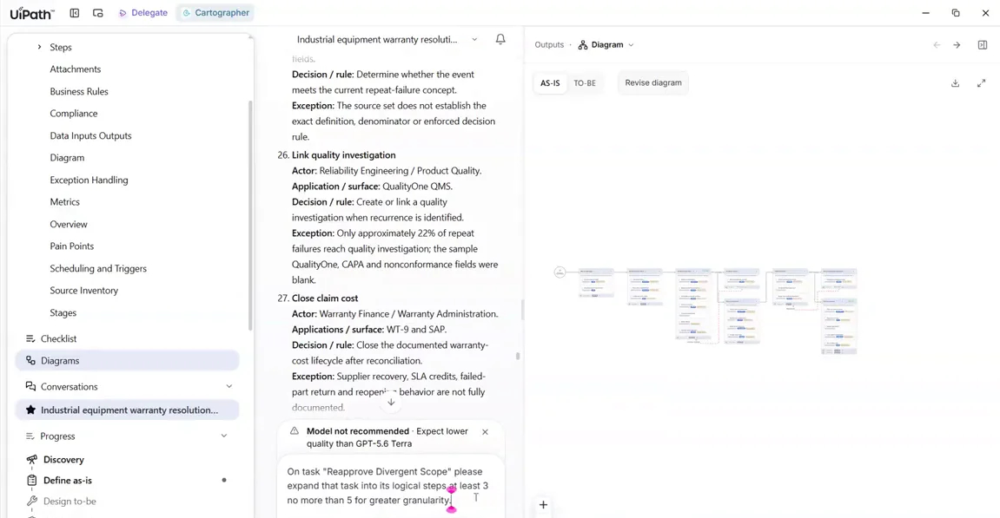
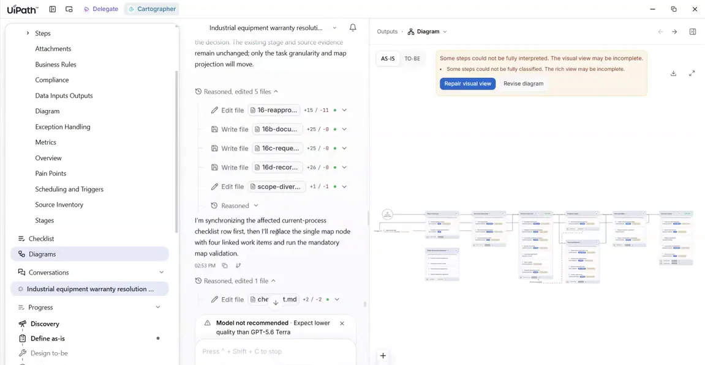
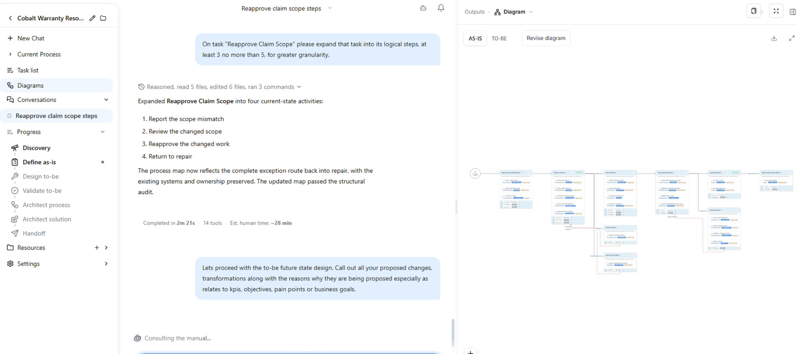
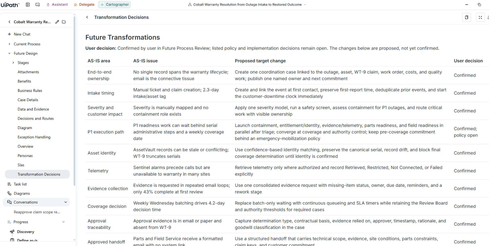

# Design the future state

## 1. Steer the level of detail on one task

In the AS-IS design, find the task **Reapprove Divergent Scope**. It's too shallow, so ask for more detail:

```text
On task "Reapprove Divergent Scope" please expand that task into its logical steps, at least 3 no more than 5, for greater granularity.
```

{ .screenshot width="900" }

The task becomes a four-step sequence: capture the divergence, document its scope, request review and record the decision. The diagram is redrawn around it.

{ .screenshot width="900" }

## 2. Ask for the future state

Once you've confirmed the AS-IS, send:

```text
Lets proceed with the to-be future state design. Call out all your proposed changes, transformations along with the reasons why they are being proposed especially as relates to kpis, objectives, pain points or business goals.
```

{ .screenshot width="900" }

The agent consults process knowledge and finds an eleven-stage reference baseline to design against. It confirms a case is still the best execution style. Then it makes its first value argument: for P1 outages, run containment, entitlement, evidence and parts in parallel, instead of waiting behind a weekly coverage date. That's in service of the 24-hour P1 objective.

!!! note "This one takes a while"
    The future-state pass runs for several minutes. A good moment for a coffee.

## 3. Review the Transformation Decisions

Open **Transformation Decisions** under **Future Design** and walk through three or four rows.

Each change gets its own row: the AS-IS area, the AS-IS issue, the proposed target change, and a **User decision** column that stays at **Proposed — Future Process Review** until you confirm it. Every change is argued against a specific number: 24-hour P1 downtime, 2.3 days of intake and asset uncertainty, a 4.2-day coverage decision, first-time fix and auditability, or the 22% of repeat failures that never reach quality investigation.

{ .screenshot width="900" }

!!! tip "Why this matters"
    This table shows whether the tool ties each change to business value or only redraws the diagram.

<div class="next-page" markdown>
[Next: Make live edits and verify them](live-edits.md){ .md-button .md-button--primary }
</div>
