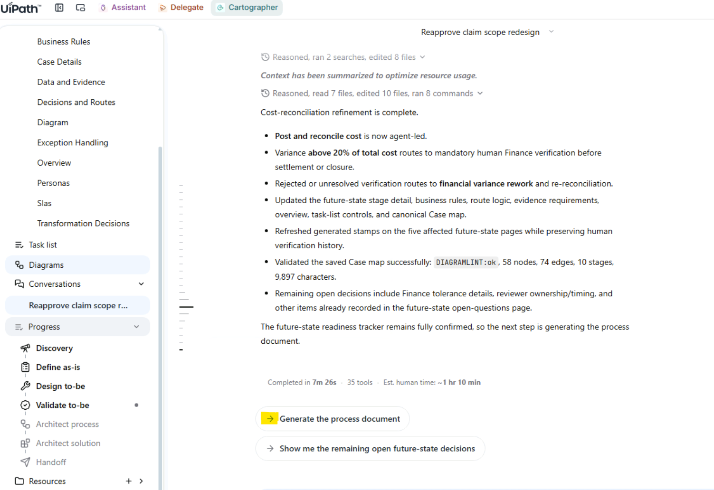
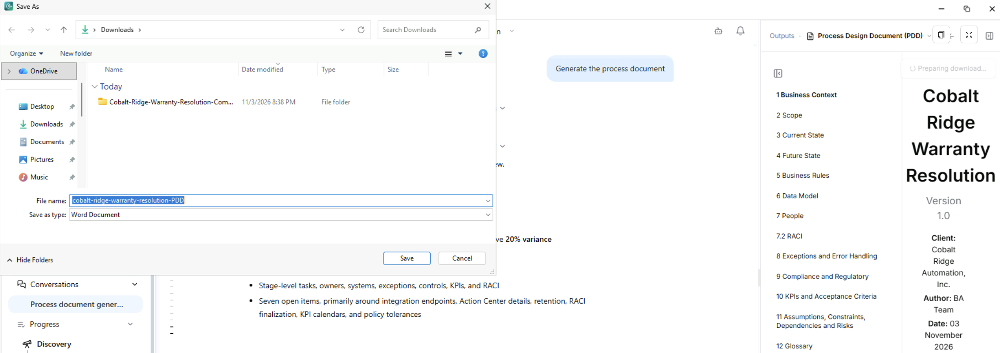
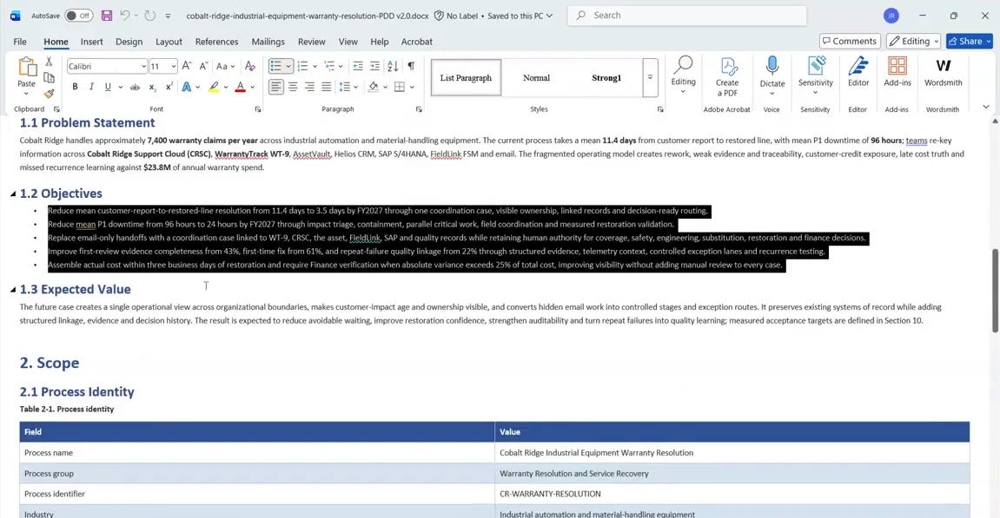
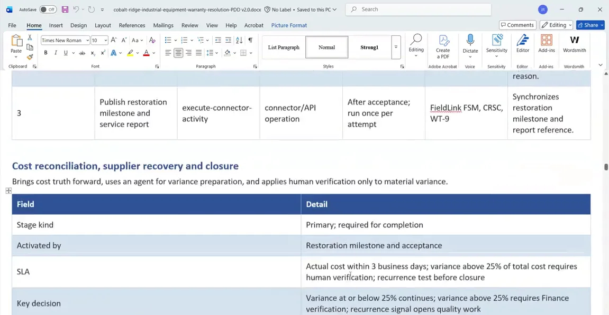
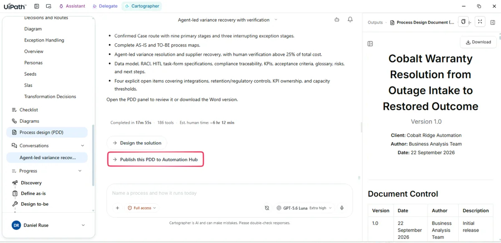
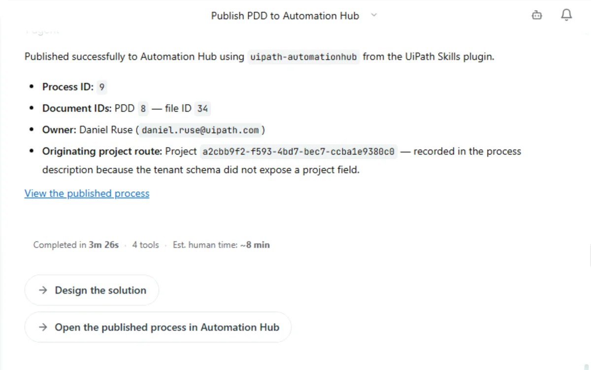
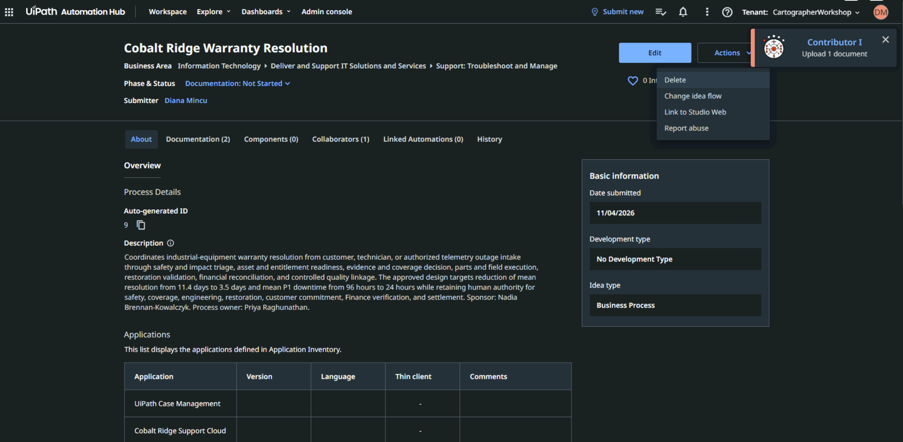

# Generate the PDD and trace it

## 1. Generate and download the PDD

1. Ask for the process document. Wait for it to generate and for the independent review to finish.

    { .screenshot width="900" }

2. Download it as Word and open it.

    { .screenshot width="900" }

The document opens with the problem statement and the objectives the project was given. You'll spot two objectives that were added mid-session: the 20% variance rule was taken up as an objective in its own right. Then come the expected value, acceptance targets, scope boundaries, the current flow with its metrics, and the impact of each pain point.

{ .screenshot width="900" }

## 2. Trace your own edits in the PDD

1. Scroll to the target flow and the **What Changes AS-IS to TO-BE** table.

    Every task in every stage has a type. That's the to-do list for the SDD. The What Changes table ties each change to the goal it serves and the metric it moves.

    { .screenshot width="900" }

2. Keep scrolling. You'll find the business rules (including the one you added live), the data model entities, a data dictionary lifted from the claim form, integrations, RACI, exceptions, human-in-the-loop and **Action Center** tasks, the compliance and regulatory matrix, and the KPI acceptance criteria.
3. Find both of your edits: the 20% variance rule, and the task you expanded earlier.

!!! tip "Where the run ends"
    This run ends at a PDD. The SDD isn't generated here. What the PDD carries is everything an SDD needs, each item traced back to the evidence and to the KPI it moves. [From Process to Production](../process-to-production/index.md) picks up the story from here.

## 3. Publish the PDD to Automation Hub

1. Once the PDD is created, choose to publish it to **Automation Hub** if you're prompted. If you aren't, ask Cartographer to do it.

    { .screenshot width="900" }

2. Cartographer gives you a link to the new entry in Automation Hub. The confirmation lists the process ID and the document IDs, and offers two follow-ups: **Design the solution** and **Open the published process in Automation Hub**.

    { .screenshot width="700" }

    { .screenshot width="900" }

[Next: Ask a teammate (optional)](ask-a-teammate.md){ .md-button .md-button--primary }

