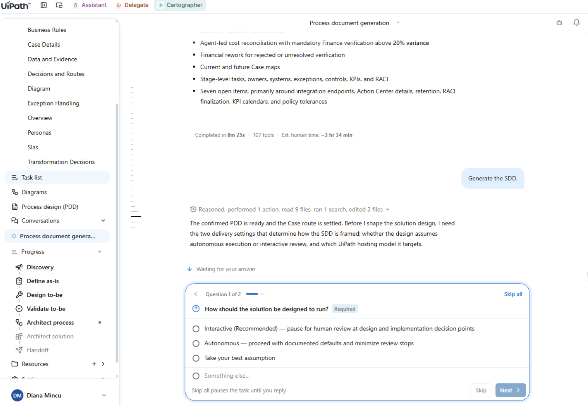
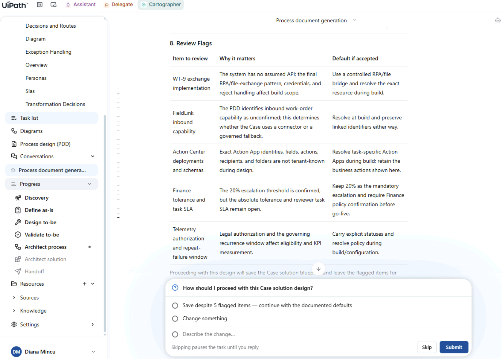
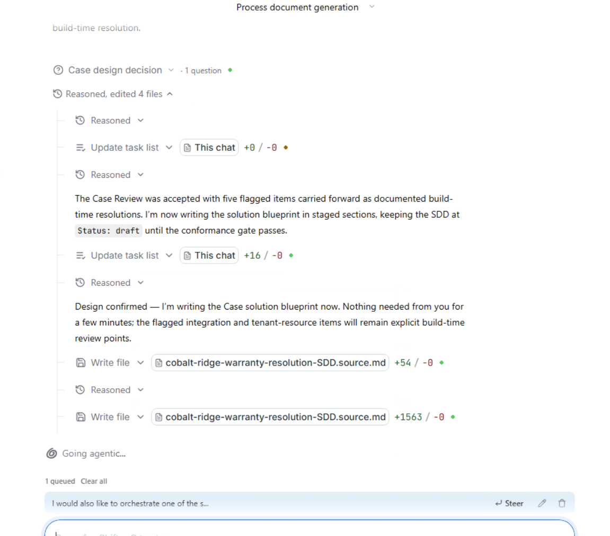
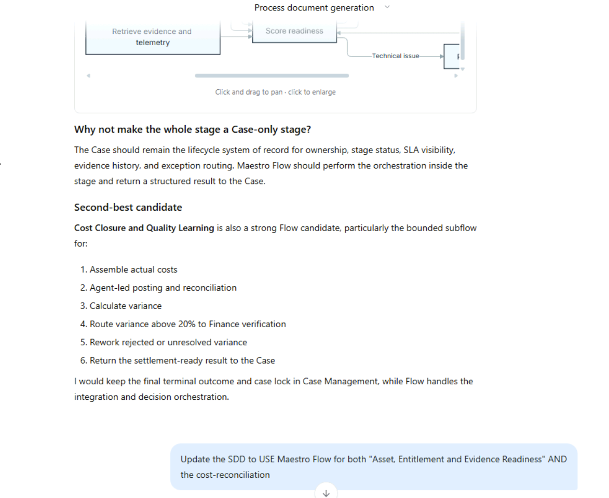
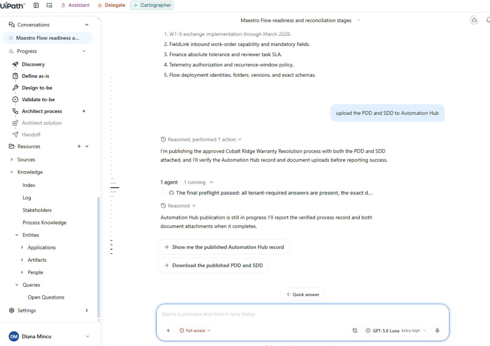
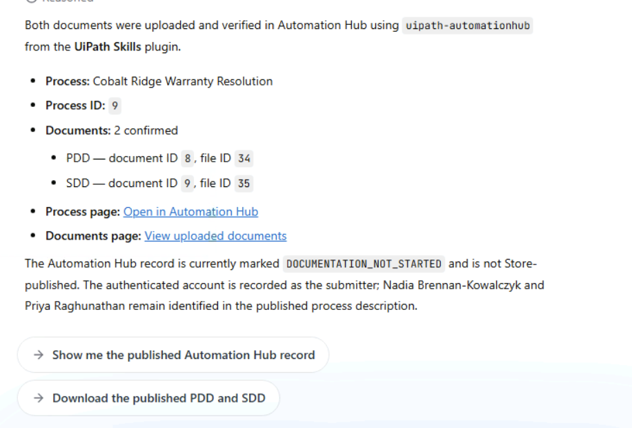
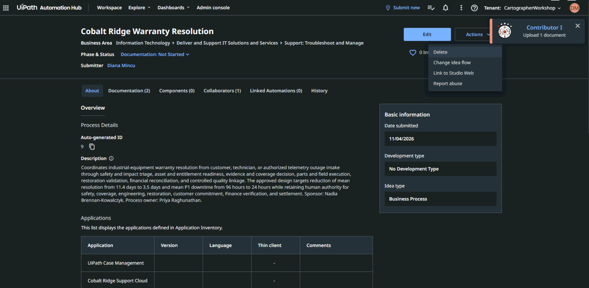

# Generate the SDD

## 1. Ask for the SDD

Once the PDD looks good, generate the Solution Design Document (SDD):

```text
Generate the SDD.
```

The first clarifying question asks how you want the generation itself to run, meaning how often it should pause for you along the way:

- **Autonomous** generates the full SDD and only interrupts for hard blockers.
- **Interactive** pauses at the summary, architecture and final SDD checkpoints instead.

Either is a valid choice. Interactive gives you more control points, and Autonomous trades them for speed.

{ .screenshot width="900" }

{ .screenshot width="900" }

## 2. Bring in Maestro Flow while it runs

While the SDD is being generated, send this prompt and click **Steer** to push it in early:

```text
I would also like to orchestrate one of the stages using Maestro Flow. Which one would be better fitted?
```

{ .screenshot width="700" }

Cartographer recommends the stages that fit **Maestro Flow** best and explains why. Choose the ones you prefer. For example:

```text
Update the SDD to USE Maestro Flow for both "Asset, Entitlement and Evidence Readiness" AND the cost-reconciliation
```

{ .screenshot width="700" }

## 3. Publish the PDD and SDD

1. Choose to publish both documents to **Automation Hub** if you're prompted. If you aren't, ask Cartographer to do it, for example:

    ```text
    upload the PDD and SDD to Automation Hub
    ```

    { .screenshot width="900" }

2. Cartographer verifies the upload and gives you links to the new entry in Automation Hub. The confirmation lists the process ID and the document IDs for the PDD and the SDD, and offers two follow-ups: **Show me the published Automation Hub record** and **Download the published PDD and SDD**.

    { .screenshot width="700" }

    { .screenshot width="900" }

<div class="next-page" markdown>
[Next: Ask a teammate (optional)](ask-a-teammate.md){ .md-button .md-button--primary }
</div>
