# Warranty Resolution at Cobalt Ridge Automation

<div class="collapsible-sections" hidden></div>

!!! tip "Here is our plan for this exercise:"

    1. Create a **Cartographer** project, give it the business brief, and check what it already knows.
    2. Feed it the evidence a real team would have and review the current state (AS-IS) it builds.
    3. Design the future state (TO-BE), make a live edit, and verify it landed everywhere.
    4. Generate the **PDD**, trace your edits inside it, and publish it to **Automation Hub**.

## Goal

By the end of this exercise you'll have taken one process from a blank project to a published Process Definition Document (PDD). You'll have a current-state wiki with provenance on every fact, a future-state design where every change is tied to a specific KPI, and a PDD that carries your own edits. That PDD is everything a Solution Design Document (SDD) needs.

## How Cartographer works

**Map the work once. Generate everything from it.** With **UiPath Cartographer**, business analysts become cartographers. Instead of weeks of interviews and a blank canvas, a guided, AI-powered discovery conversation turns scattered process knowledge into one living definition of how the work runs: the **Map of Work**.

<div class="flow-cards" markdown>
<div class="flow-card" markdown>
<span class="flow-label">Bring what you have</span>

- SOPs and policies
- Recorded walkthroughs
- Workshop notes
- Task captures
</div>
<div class="flow-card" markdown>
<span class="flow-label">Cartographer</span>

- **Starts with context:** universal, domain and your own knowledge
- **Asks only what's missing**
- **Reconciles your evidence** and flags contradictions
- **Brings in the experts** who know the answer
</div>
<div class="flow-card accent" markdown>
<span class="flow-label">Map of Work</span>

People, stages, systems and data, rules, exceptions, judgment and goals. Versioned, with a named owner and approver, and provenance on every fact.
</div>
<div class="flow-card" markdown>
<span class="flow-label">Generated from the map</span>

- **PDD** for decision-makers
- **SDD** for developers and coding agents
- **Best-fit canvas:** Case, BPMN or Flow, with the reasoning behind it
</div>
</div>

Three ideas make the result something you can trust and build from:

- **Every fact is attributable.** Each element carries its source and the person who verified it. Contradictions get resolved, not averaged.
- **No blank page.** Cartographer already knows the usual shape of a process in your industry, and **Process Atlas** brings expert-attested maps you adapt rather than draw. It only asks what it can't work out.
- **Change the map, regenerate.** Your documents are generated from the Map of Work, so nothing downstream drifts out of sync with how the business actually runs.

You'll see every one of these in action in this exercise.

## About Cobalt Ridge Automation

Cobalt Ridge Automation builds industrial automation and material-handling equipment. When a customer's sortation line goes down, getting it running again is everybody's problem, and nobody's process.

<div class="stat-grid" markdown>
<div class="stat-tile"><b>~7,400</b><span>warranty claims a year</span></div>
<div class="stat-tile"><b>11.4 days</b><span>mean time from customer report to restored line</span></div>
<div class="stat-tile"><b>96 hours</b><span>mean downtime for a P1 line outage</span></div>
<div class="stat-tile"><b>$23.8M</b><span>annual warranty spend</span></div>
</div>

**Seven functions** pull together on every outage:

<div class="chip-row"><span>Support</span><span>Warranty administration</span><span>Engineering</span><span>Parts</span><span>Field service</span><span>Finance</span><span>Quality</span></div>

**Six systems and one very long email thread** hold the work:

<div class="chip-row systems"><span>Support Cloud (CRSC)</span><span>WarrantyTrack WT-9</span><span>AssetVault</span><span>Helios CRM</span><span>SAP S/4HANA</span><span>FieldLink FSM</span><span>Email</span></div>

What drives the cost: manual re-keying, a weekly coverage gate, undocumented parts substitutions, late cost posting and repeat failures nobody links together.

<div class="brief-card" markdown>
<span class="flow-label">The brief for FY2027</span>

<div class="target-row"><span class="from">11.4 days</span><span class="arrow">&rarr;</span><span class="to">3.5 days</span><span class="what">mean resolution time</span></div>
<div class="target-row"><span class="from">96 hours</span><span class="arrow">&rarr;</span><span class="to">24 hours</span><span class="what">P1 line downtime</span></div>

People keep authority over coverage, safety, engineering, substitution, restoration and finance decisions. **Your job is to design how.**
</div>

## Prerequisites

!!! info "Before you begin: prerequisites"
    Have these ready **before** the session:

    - **The workshop VM** — or the latest Cartographer build installed on your own machine.
    - **Your UiPath account** — you'll register it on the machine and use it to sign in to the UiPath Assistant.
    - **A UiPath Cloud account**. In this workshop we will use: `{{ training_url }}/{{ training_tenant }}`. Talk to your trainer if you are not invited.

### 1. Connect to the VM

- **In a live workshop:** connect to the virtual machine your trainer provides.
- **Self-paced (UiPath internal):** create a new UiPath Studio & Robot sandbox on [uipathlabs.uipath.com/sandboxes/new](https://uipathlabs.uipath.com/sandboxes/new) and pick the **Internal Enablement Workshop** template.

You can skip the VM entirely if you already have the latest Cartographer build installed on your machine.

### 2. Register your VM

[[[
1. In the Windows search bar, type **Email & accounts**.
2. Click **Add a work or school account**.
3. Sign in with your UiPath account.
|30|
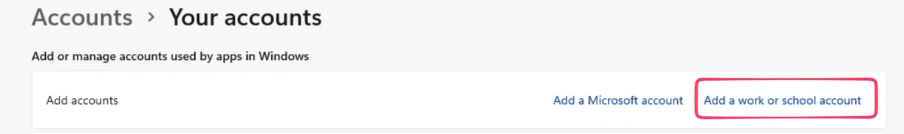{ .screenshot }
]]]

### 3. Open the Assistant

1. Open the **UiPath Assistant** and sign in with your UiPath account (via Microsoft).
2. Connect to the **{{ training_tenant }}** tenant at **[{{ training_url }}]({{ training_url }})**.

!!! note "Working self-paced?"
    You can connect to any other environment you have access to, for example `staging.uipath.com/uipathlabs` or `cloud.uipath.com/uipathlabs` with the Playground tenant.

## Set up the project and check its knowledge

### 1. Create the project and give it the brief

1. Open **Cartographer**. On the home screen, click the **+** icon next to **Business Processes** in the left panel.

    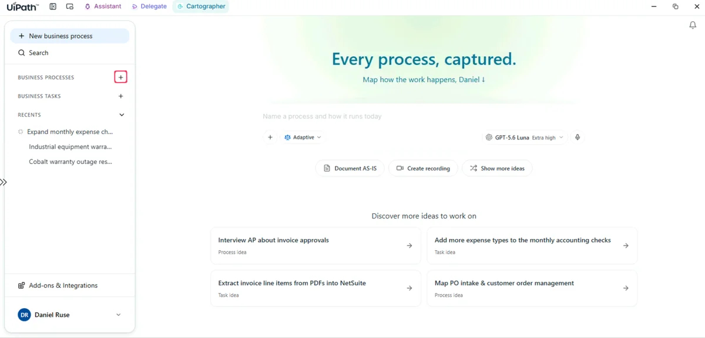{ .screenshot width="900" }

2. The **New project** dialog opens. It has a **Name** field and a **Project instructions** box that already contains a generic default paragraph.

    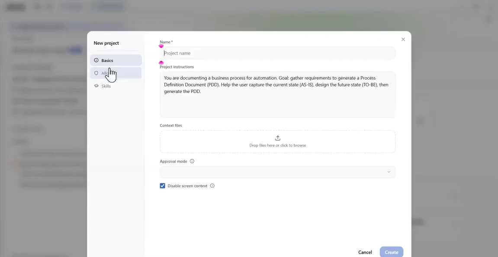{ .screenshot width="900" }

3. In **Name**, type:

    ```text
    Cobalt Warranty Resolution from Outage Intake to Restored Outcome
    ```

4. In **Project instructions**, leave the default paragraph where it is. Paste the brief below straight after it, so the box reads as one continuous set of instructions:

    ```markdown
    #context:
    Cobalt Ridge Automation handles approximately 7,400 warranty claims each year across industrial automation and material-handling equipment. The current process takes a mean 11.4 days from customer report to restored line, with mean P1 downtime of 96 hours, while data and work are fragmented across Cobalt Ridge Support Cloud (CRSC), WarrantyTrack WT-9, AssetVault, Helios CRM, SAP S/4HANA, FieldLink FSM, and email. Manual re-keying, a weekly coverage gate, undocumented parts substitutions, late cost posting, and weak repeat-failure linkage drive rework, customer-credit exposure, and $23.8M of annual warranty spend.

    # Objectives

    - Reduce mean resolution time from 11.4 days to 3.5 days by FY2027 through an immediate coordination case, six sequential primary stages, conditional supporting stages, automated follow-up, and visible handoffs.

    - Reduce P1 line downtime from 96 hours to 24 hours by FY2027 through impact triage, managed containment, field-work coordination, and restoration validation.

    - Replace email-only work handoffs with a coordination case linked to WT-9, while retaining human authority for coverage, safety, engineering, substitution, restoration, and finance decisions.

    - Improve evidence completeness, decision traceability, cost-reconciliation visibility, and repeat-failure learning through active stages, timing controls, and linked quality work.
    ```

5. Check that the dialog now shows your title and the full instructions.

    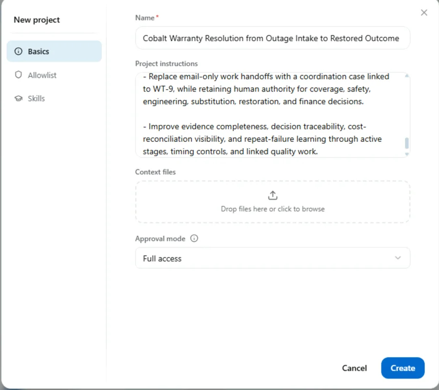{ .screenshot width="600" }

6. Leave **Context files** empty and **Approval mode** at its default. Keep **Disable screen context** checked, then click **Create**.

You now have an empty project with no conversations yet. The **Business Analysis** and **project-checklist** skills are listed, and your instructions sit in the right panel.

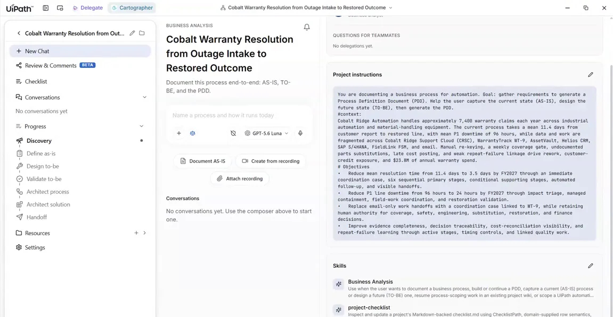{ .screenshot width="900" }

### 2. Ask what it already knows, before uploading anything

Don't upload anything yet. Paste this into the composer and send it:

```text
Verify your process-knowledge / process-skills and answer only from it:

(1) the 3 KPIs that typically matter most for industrial-equipment warranty resolution, with reference baselines and targets;

(2) the compliance and audit controls this process must enforce;

(3) the persona titles who run it, by stage;

(4) where UiPath best-practice suggests Document Understanding vs. DMN / business rules vs. AI Agent.
```

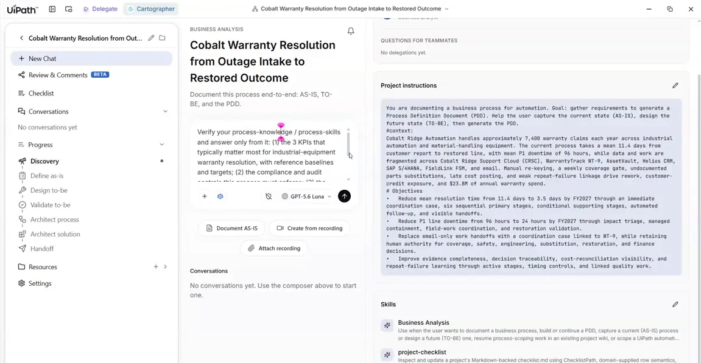{ .screenshot width="900" }

The agent consults its **Process Knowledge** and answers all four parts. You get KPIs with reference baselines plus good and stretch targets, a list of controls, personas by stage, and a component-placement table covering Document Understanding, DMN and business rules, AI agents and human-in-the-loop.

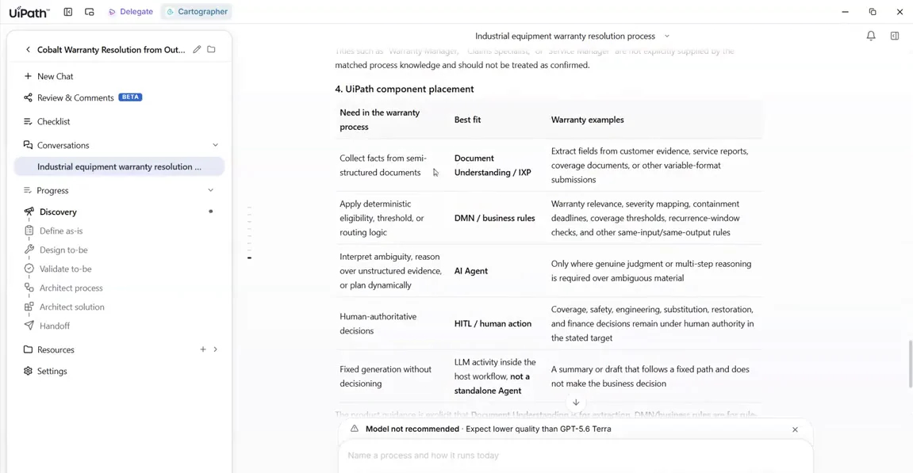{ .screenshot width="900" }

!!! tip "Why this matters"
    Anything that comes from process knowledge rather than from your own documents is flagged as **not confirmed**. Cartographer never passes off a general industry assumption as one of your facts.

## Capture and review the AS-IS

### 1. Add the evidence

The evidence pack is the kind of material a team already has: process flows from two departments, a process-owner interview, a workshop transcript, an executive brief, a systems architecture draft and a printed claim record.

[[[
1. On the VM desktop, open the **Cobalt Ridge Industrial Equipment Warranty Resolution-FUSION** folder. It holds the evidence files.
2. Attach the files listed below and send them with this prompt:
|50|
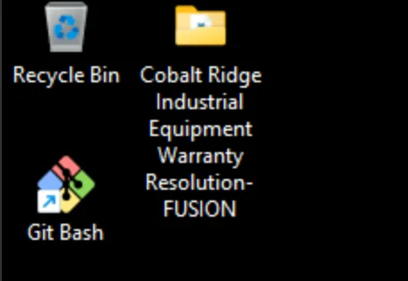{ .screenshot }
]]]

```text
Add to the AS-IS references.
```

!!! info "Using your own machine instead of the VM?"
    Download the evidence pack and unzip it anywhere on your machine:

    [**Download the Cobalt Ridge evidence pack (.zip)**](dependencies/Cobalt-Ridge-Warranty-Resolution-Company-Source.zip){ .md-button download="Cobalt-Ridge-Warranty-Resolution-Company-Source.zip" }

    It contains the same files as the folder on the VM desktop.

**Files to attach:**

- `a_process_flows/CobaltRidge_FieldService-and-Parts_Dispatch-and-Fulfillment_AS-IS.svg`
- `a_process_flows/CobaltRidge_Support-and-Warranty-Admin_Claim-Intake-and-Adjudication_CURRENT-STATE.pptx`
- `b_process_owner_interview/Interview_Priya-Raghunathan_Warranty-Process-Owner_2026-02-19.docx`
- `c_workshop_transcript/Workshop-Transcript_Warranty-Resolution-Current-State_2026-03-26.docx`
- `d_executive_brief/CobaltRidge_Warranty-Resolution-Transformation_Executive-Brief_FY2027.pptx`
- `e_systems_architecture/CobaltRidge_Warranty-Systems-Architecture_Current-State_v0.9-DRAFT.docx`
- `e_systems_architecture/CobaltRidge_Warranty-Systems-Landscape_Current-State.svg`
- `f_claim_record/WC-2026-04871_WarrantyTrack-WT9_Full-Claim-Record_PRINTED.docx`

!!! warning "Leave these two files out"
    - `00_START_HERE_BA-notes.md` — background for the facilitator, not input for the agent.
    - `meta-DO-NOT-FEED-TO-AGENT.txt` — held back on purpose. It's used to test provenance tracking.

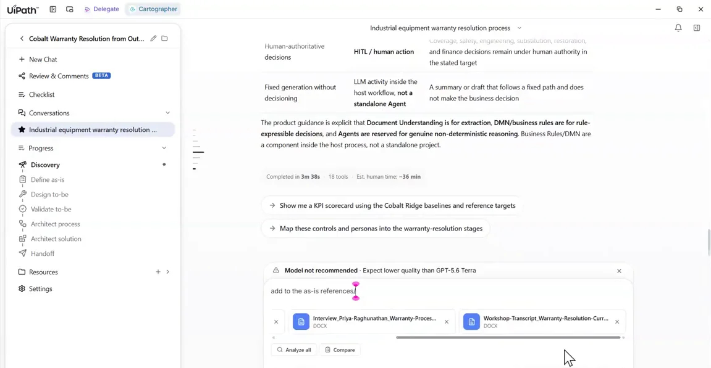{ .screenshot width="900" }

### 2. Watch the current-state wiki build

While the agent reads, open **Current Process** in the left navigation and follow the pages as it writes them: **Overview**, **Business Rules**, **Compliance**, **Data Inputs Outputs**, **Exception Handling**, **Metrics**, **Pain Points**, **Scheduling and Triggers** and **Source Inventory**.

The files appear one by one. When it's done, the agent tells you the source-grounded facts are written and it's synchronizing the checklist.

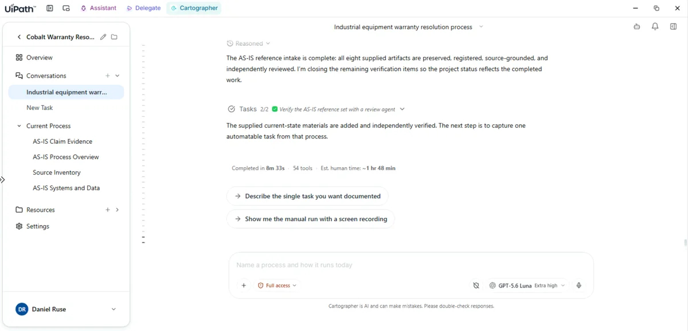{ .screenshot width="900" }

### 3. Check the provenance on a captured item

Open **Pain Points** and expand **Sources and Metadata** at the top of the page.

You can see which agent captured each item and when, the source documents and the exact sections it came from, and the file metadata. This provenance stays attached for the whole life of the Map of Work.

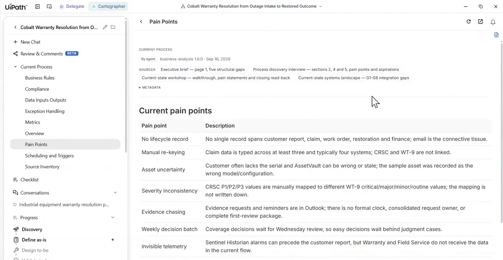{ .screenshot width="900" }

### 4. Choose the map format, then read the checklist

1. The agent asks how today's process should be mapped. It offers a case map (recommended), a BPMN model or a simple flow. Read its reasoning, then pick **case map**.

    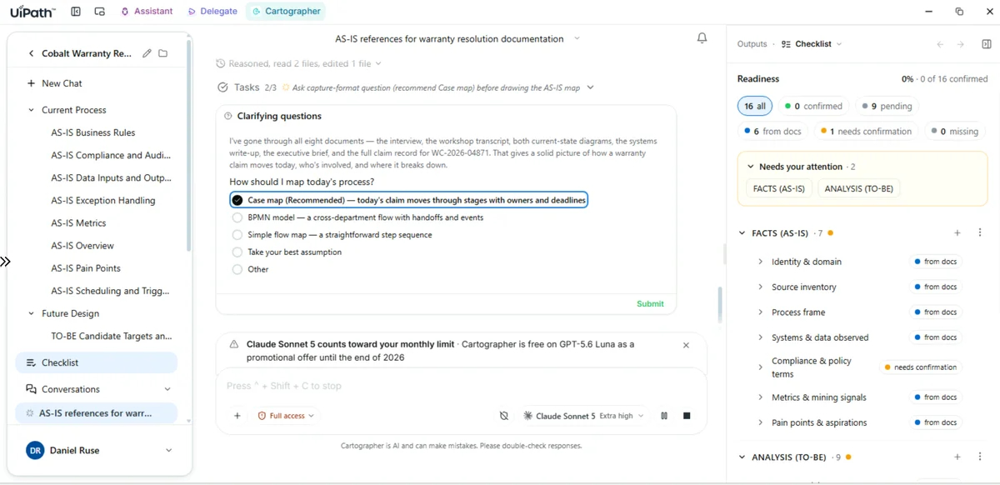{ .screenshot width="900" }

2. Open the **Checklist** panel. You'll see a readiness count, plus how many rows are confirmed, pending, sourced from documents, need confirmation or are missing. Yellow tags mark anything the agent assumed from process knowledge rather than took from your documents.

    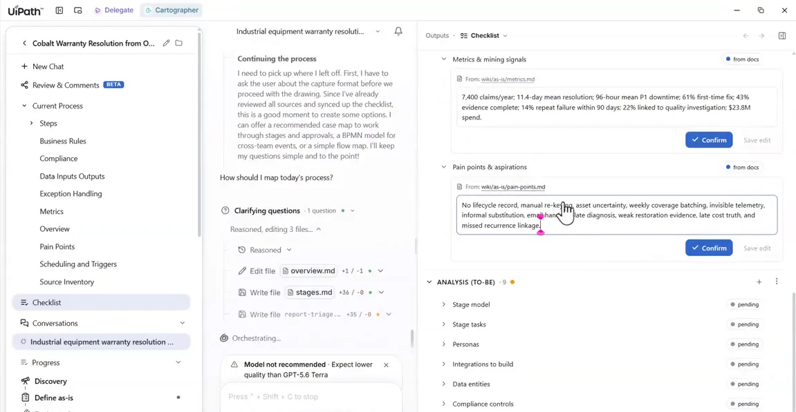{ .screenshot width="900" }

    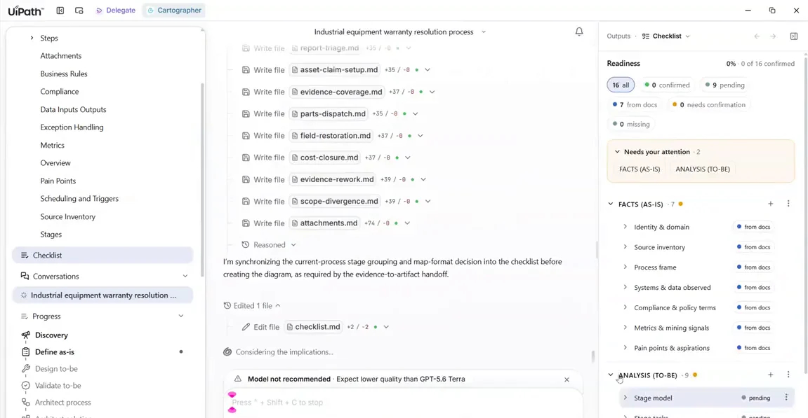{ .screenshot width="900" }

## Design the future state

### 1. Steer the level of detail on one task

In the AS-IS design, find the task **Reapprove Divergent Scope**. It's too shallow, so ask for more detail:

```text
On task "Reapprove Divergent Scope" please expand that task into its logical steps, at least 3 no more than 5, for greater granularity.
```

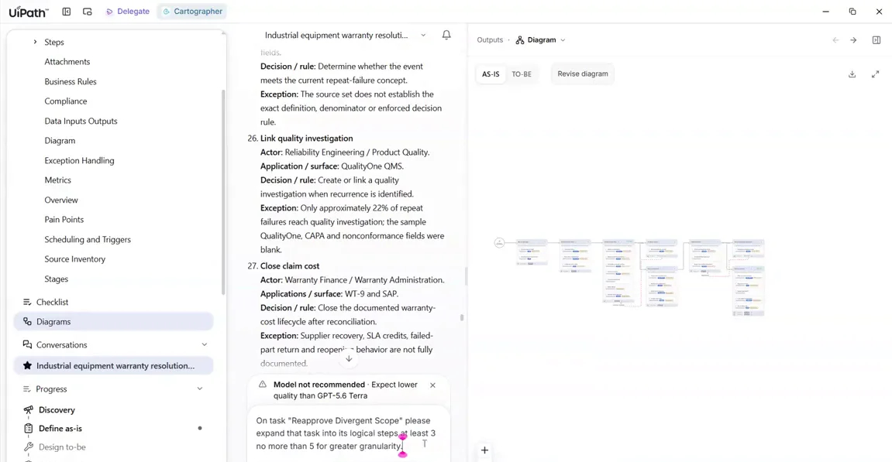{ .screenshot width="900" }

The task becomes a four-step sequence: capture the divergence, document its scope, request review and record the decision. The diagram is redrawn around it.

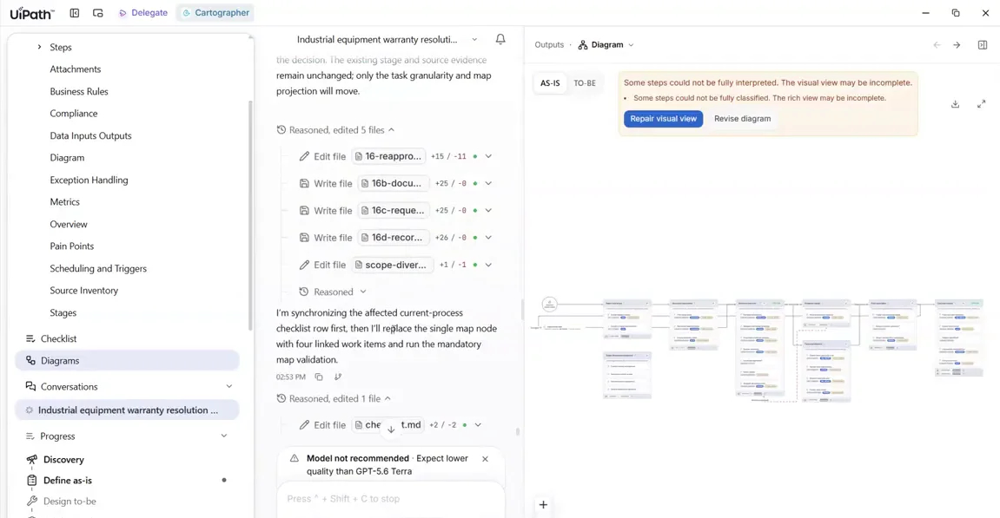{ .screenshot width="900" }

### 2. Ask for the future state

Once you've confirmed the AS-IS, send:

```text
Lets proceed with the to-be future state design. Call out all your proposed changes, transformations along with the reasons why they are being proposed especially as relates to kpis, objectives, pain points or business goals.
```

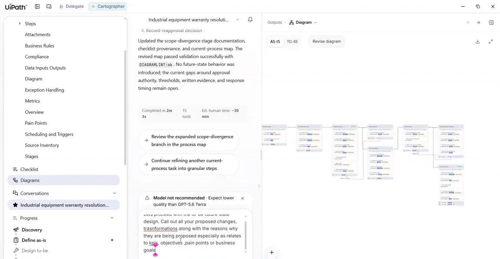{ .screenshot width="900" }

The agent consults process knowledge and finds an eleven-stage reference baseline to design against. It confirms a case is still the best execution style. Then it makes its first value argument: for P1 outages, run containment, entitlement, evidence and parts in parallel, instead of waiting behind a weekly coverage date. That's in service of the 24-hour P1 objective.

!!! note "This one takes a while"
    The future-state pass runs for several minutes. A good moment for a coffee.

### 3. Review the Transformation Decisions

Open **Transformation Decisions** under **Future Design** and walk through three or four rows.

Each change gets its own row: the AS-IS area, the AS-IS issue, the proposed target change, and a **User decision** column that stays at **Proposed — Future Process Review** until you confirm it. Every change is argued against a specific number: 24-hour P1 downtime, 2.3 days of intake and asset uncertainty, a 4.2-day coverage decision, first-time fix and auditability, or the 22% of repeat failures that never reach quality investigation.

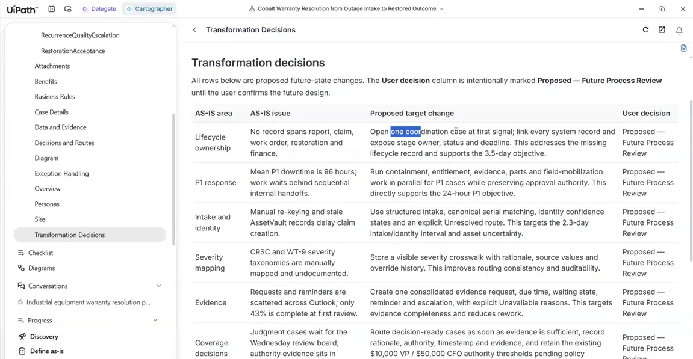{ .screenshot width="900" }

!!! tip "Why this matters"
    This is the artifact that answers the big question: does the tool tie changes to business value, or does it just redraw the diagram?

## Make live edits and verify them

### 1. Make the agentic edit, and use Steer

1. In the future-state design, find the finance human task **Resolve variance and recovery**. Send:

    ```text
    In resolve variance and recovery, it is listed as a human task. Change this to be conducted by an agent with human verification when variance exceeds 25% of total cost.
    ```

    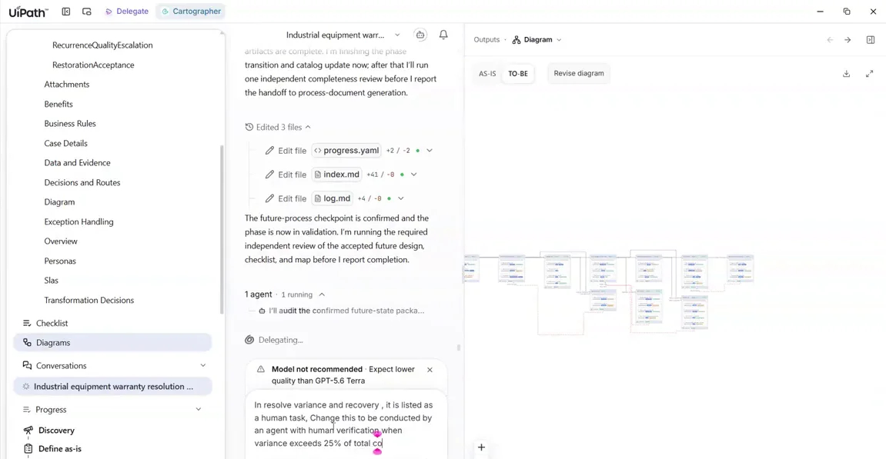{ .screenshot width="900" }

2. The agent is probably halfway through a multi-step validation pass. There's no point waiting for a pass that's about to be outdated, so click **Steer** on the queued message to push your request in early.

3. The request is accepted as a refinement. The agent updates the future case design, the business rules, the agentic task list and the transformation list. Then a second agent runs an independent review of the first one's work.

    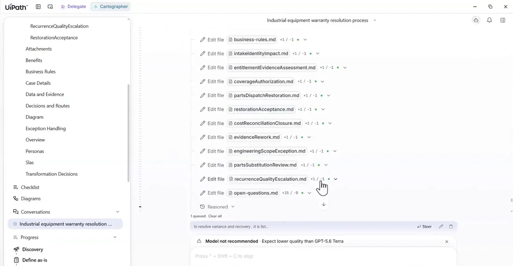{ .screenshot width="900" }

!!! tip "Compliance guardrails"
    Every request is checked against known compliance rules, from regulators or from the company. A change that broke one, for example *no agent may approve any variance*, would be refused and explained, not silently accepted.

### 2. Verify the change landed everywhere

Run three checks:

1. **The TO-BE diagram.** Find the cost reconciliation stage. **Resolve variance and recovery** now carries an **AI agent** tag, followed by a **Variance over 25%?** decision and **Verify high variance disposition** as a human action. Check that nothing else in the process moved.

    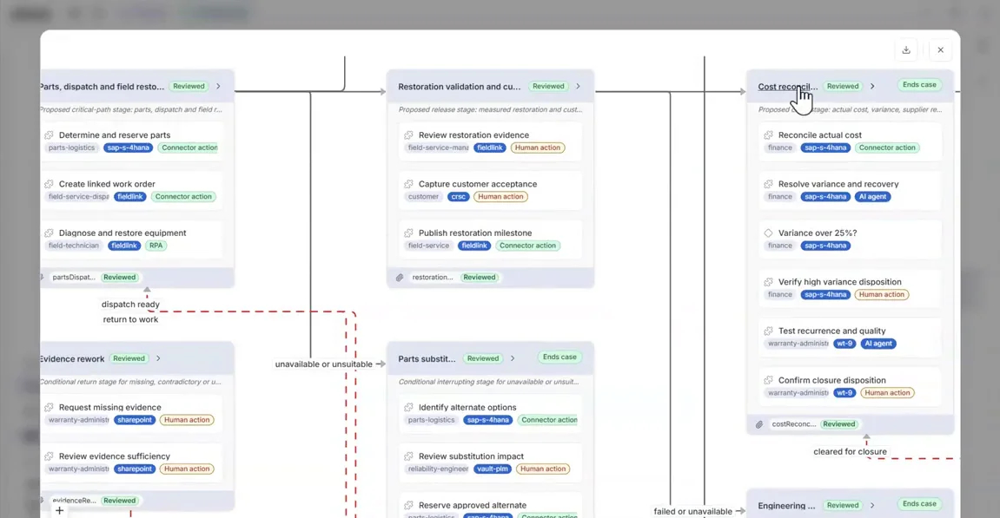{ .screenshot width="900" }

2. **Business Rules in the wiki.** The new business rule is there, and it's confirmed.

    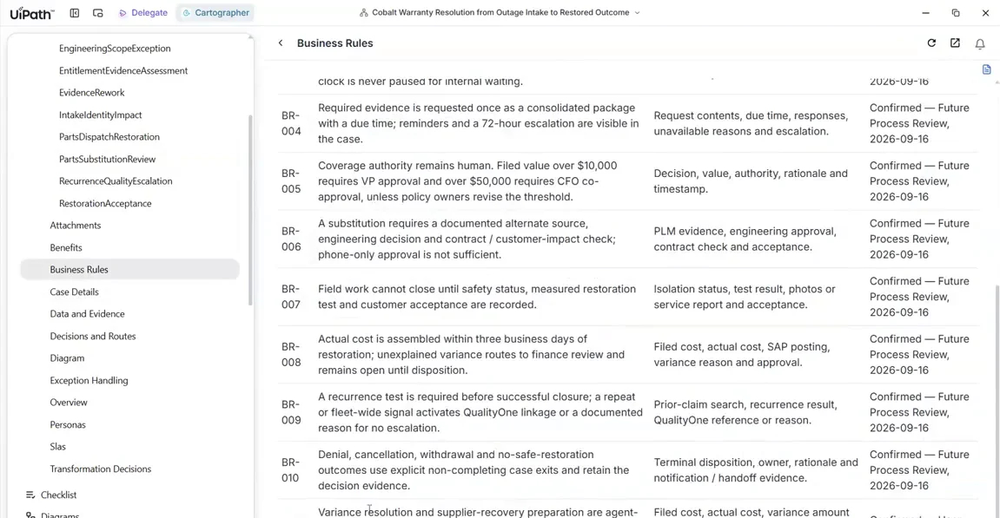{ .screenshot width="900" }

3. **Transformation Decisions.** Your change is correctly *absent*. It was your explicit instruction, not a transformation the agent proposed.

## Generate the PDD and trace it

### 1. Generate and download the PDD

1. Ask for the process document. Wait for it to generate and for the independent review to finish.
2. Download it as Word and open it.

    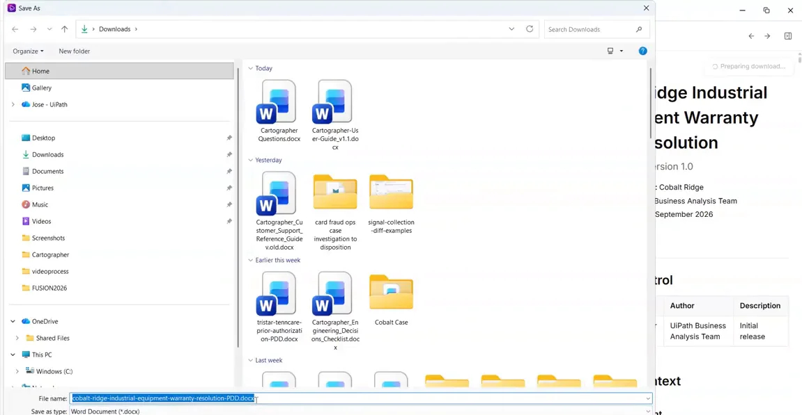{ .screenshot width="900" }

The document opens with the problem statement and the objectives the project was given. You'll spot two objectives that were added mid-session: the 25% change was taken up as an objective in its own right. Then come the expected value, acceptance targets, scope boundaries, the current flow with its metrics, and the impact of each pain point.

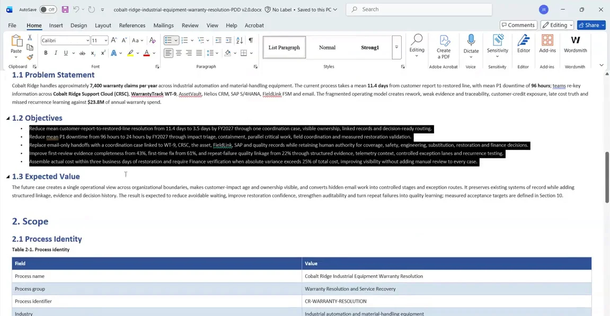{ .screenshot width="900" }

### 2. Trace your own edits in the PDD

1. Scroll to the target flow and the **What Changes AS-IS to TO-BE** table.

    Every task in every stage has a type. That's the to-do list for the SDD. The What Changes table ties each change to the goal it serves and the metric it moves.

    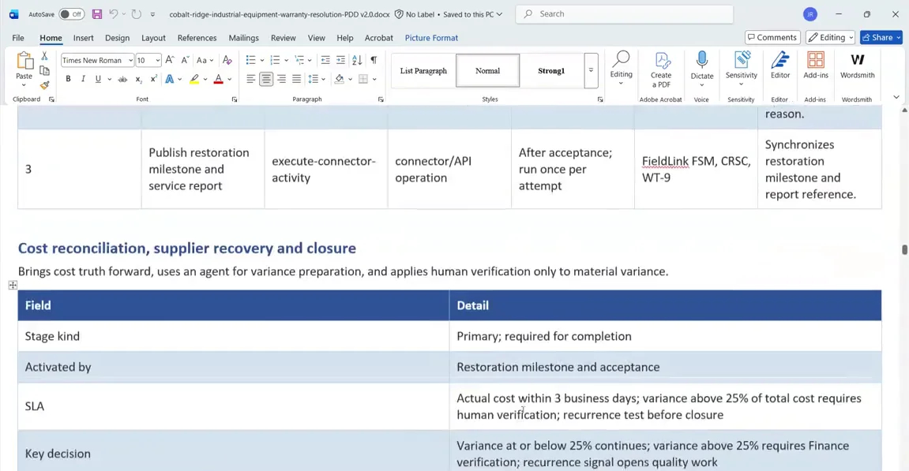{ .screenshot width="900" }

2. Keep scrolling. You'll find the business rules (including the one you added live), the data model entities, a data dictionary lifted from the claim form, integrations, RACI, exceptions, human-in-the-loop and **Action Center** tasks, the compliance and regulatory matrix, and the KPI acceptance criteria.
3. Find both of your edits: the 25% variance decision, and the task you expanded earlier.

!!! tip "Where the run ends"
    This run ends at a PDD. The SDD isn't generated here. What the PDD carries is everything an SDD needs, each item traced back to the evidence and to the KPI it moves. [From Process to Production](../process-to-production/index.md) picks up the story from here.

### 3. Publish the PDD to Automation Hub

1. Once the PDD is created, choose to publish it to **Automation Hub** if you're prompted. If you aren't, ask Cartographer to do it.

    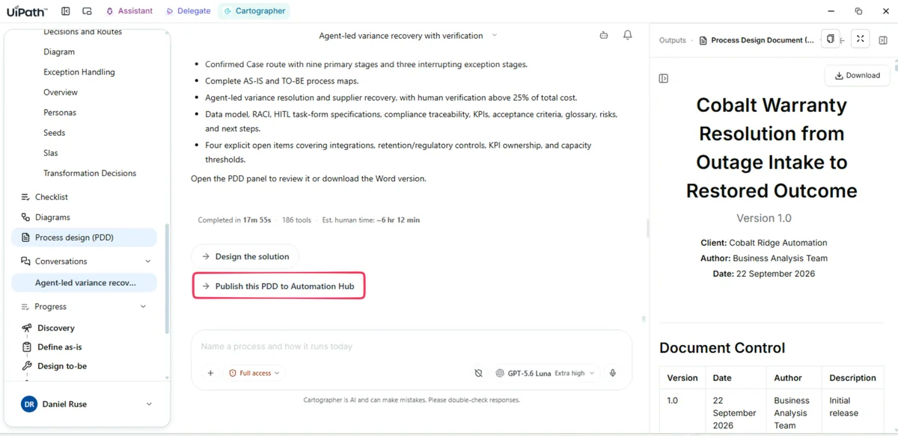{ .screenshot width="900" }

2. Cartographer gives you a link to the new entry in Automation Hub. The confirmation lists the process ID and the document IDs, and offers two follow-ups: **Design the solution** and **Open the published process in Automation Hub**.

    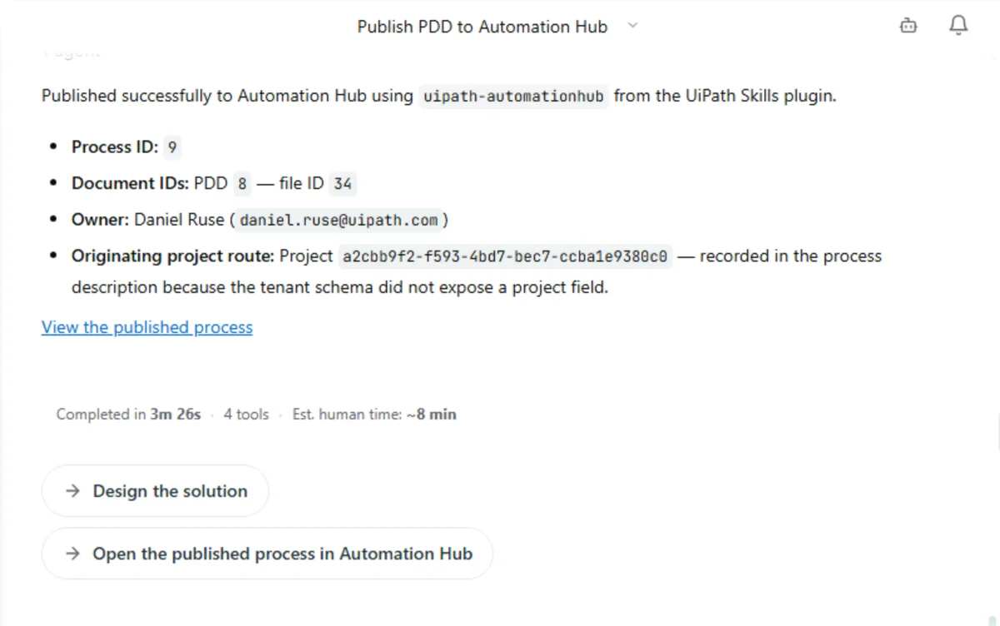{ .screenshot width="700" }

    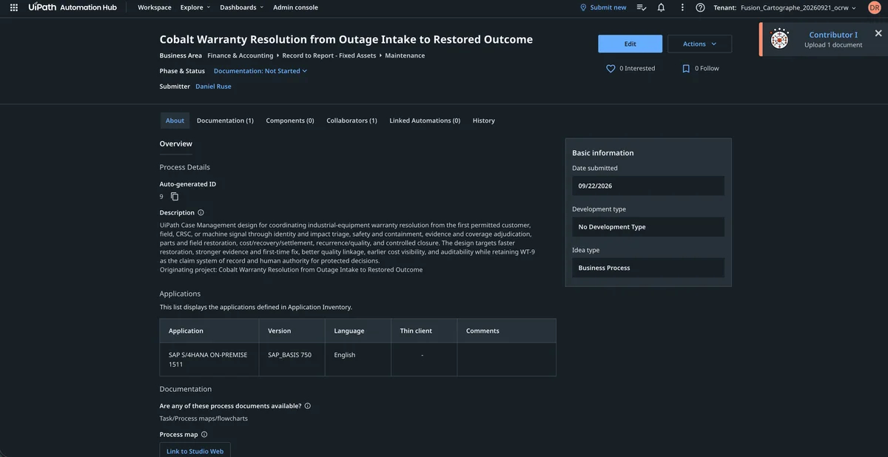{ .screenshot width="900" }

## Optional: ask a teammate

Only run this if you're ahead of the clock. Pair up, so someone is there to answer.

Is 25% the right variance threshold? Instead of guessing, delegate the question to finance from inside the conversation.

1. Use **Ask a teammate** to write your question.

    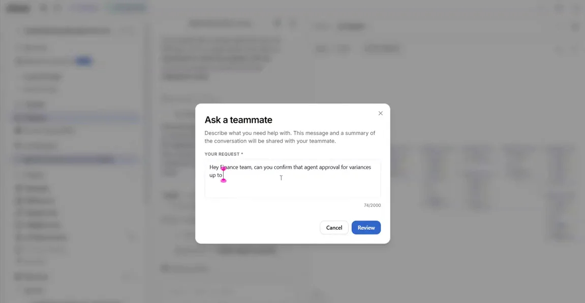{ .screenshot width="900" }

2. Generate the shareable link and send it to your partner.

    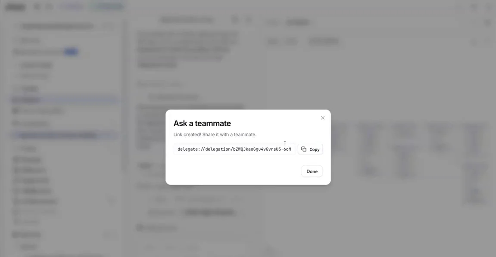{ .screenshot width="900" }

The link opens a session for your colleague with the question and its context already loaded. Their answer lands back in your conversation, ready for you to accept.

!!! tip "Training Environment"
    Log in at **[{{ training_url }}]({{ training_url }})** and remember using tenant **{{ training_tenant }}** for this exercise.
