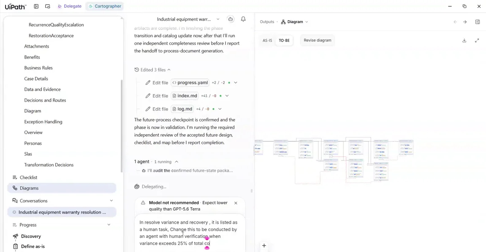
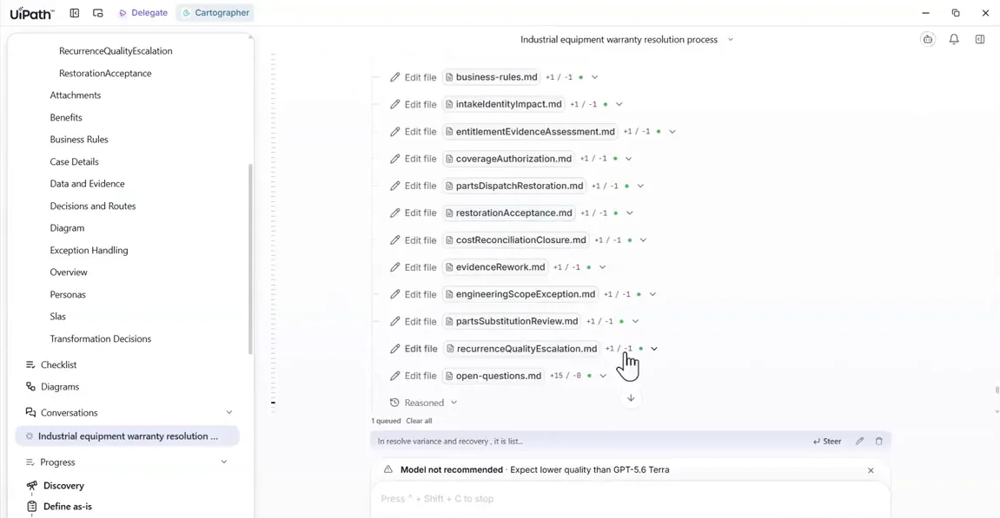
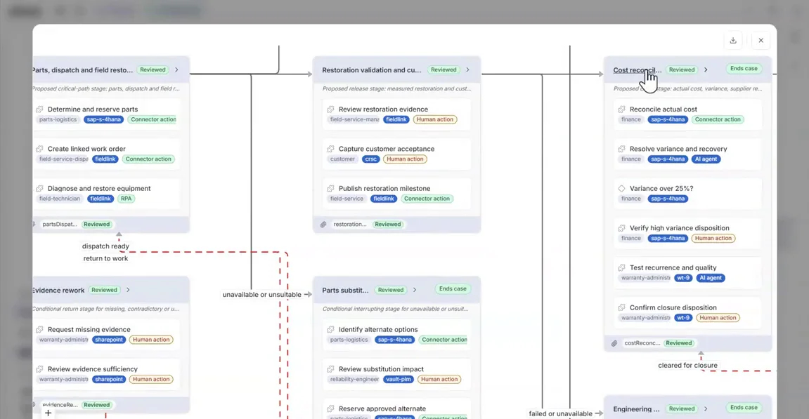
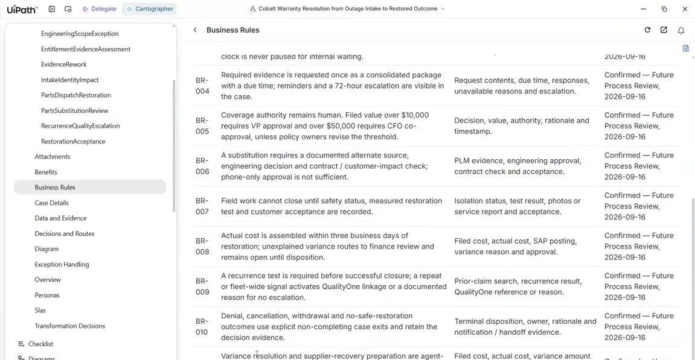

# Make live edits and verify them

## 1. Make the agentic edit, and use Steer

1. In the future-state design, find the finance human task **Resolve variance and recovery**. Send:

    ```text
    In resolve variance and recovery, it is listed as a human task. Change this to be conducted by an agent with human verification when variance exceeds 25% of total cost.
    ```

    { .screenshot width="900" }

2. The agent is probably halfway through a multi-step validation pass. There's no point waiting for a pass that's about to be outdated, so click **Steer** on the queued message to push your request in early.

3. The request is accepted as a refinement. The agent updates the future case design, the business rules, the agentic task list and the transformation list. Then a second agent runs an independent review of the first one's work.

    { .screenshot width="900" }

!!! tip "Compliance guardrails"
    Every request is checked against known compliance rules, from regulators or from the company. A change that broke one, for example *no agent may approve any variance*, Cartographer would refuse it and explain why.

## 2. Verify the change landed everywhere

Run three checks:

1. **The TO-BE diagram.** Find the cost reconciliation stage. **Resolve variance and recovery** now carries an **AI agent** tag, followed by a **Variance over 25%?** decision and **Verify high variance disposition** as a human action. Check that nothing else in the process moved.

    { .screenshot width="900" }

2. **Business Rules in the wiki.** The new business rule is there, and it's confirmed.

    { .screenshot width="900" }

3. **Transformation Decisions.** Your change is correctly *absent*. It was your explicit instruction, not a transformation the agent proposed.

<div class="next-page" markdown>
[Next: Generate and trace the PDD](generate-pdd.md){ .md-button .md-button--primary }
</div>
