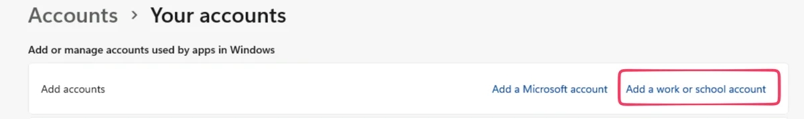

# Prerequisites

!!! info "Before you begin"
    Have these ready **before** the session:

    - **A machine with Cartographer:** the workshop VM, or your own machine with Cartographer installed.
    - **Your UiPath account:** you'll use it to sign in to the **UiPath Assistant**.
    - **Access to the workshop environment:** in this workshop we use `{{ training_url }}/{{ training_tenant }}`. Talk to your trainer if you haven't received an invitation.

## 1. Using a VM

If you don't have Cartographer installed on your own machine, connect to the virtual machine your trainer provides. Prior to the training, you'll receive an email with an invitation to a UiPath Studio & Robot sandbox environment.

After you confirm your attendance, the sandbox gets created and you can open it.

### Optional: you might need to Register your VM

[[[
1. In the Windows search bar, type **Email & accounts**.
2. Click **Add a work or school account**.
3. Sign in with your UiPath account.
|30|
{ .screenshot }
]]]

## 2. Using your own machine

If you prefer to use your own machine, make sure it meets these prerequisites:

- Windows, with **UiPath Assistant STS version 26.10.202 or later**, installed from the "Studio, Assistant and Robot STS" download in Automation Cloud. The Cartographer tab doesn't appear in LTS versions (2025.10 or older).
- Assistant installed with the Robot in **attended (user) mode**. Sign-in doesn't work when the Robot runs as a Windows service.
- PowerShell allowed on the machine, since Cartographer uses it to start.
- A UiPath user license other than Express.

## 3. Open the Assistant

1. Open the **UiPath Assistant** and sign in with your UiPath account (via Microsoft).
2. Connect to the **{{ training_tenant }}** tenant at **[{{ training_url }}]({{ training_url }})**.

!!! note "Working self-paced?"
    You can connect to any other environment and tenant you have access to.

[Next: Set up the project](set-up-project.md){ .md-button .md-button--primary }

