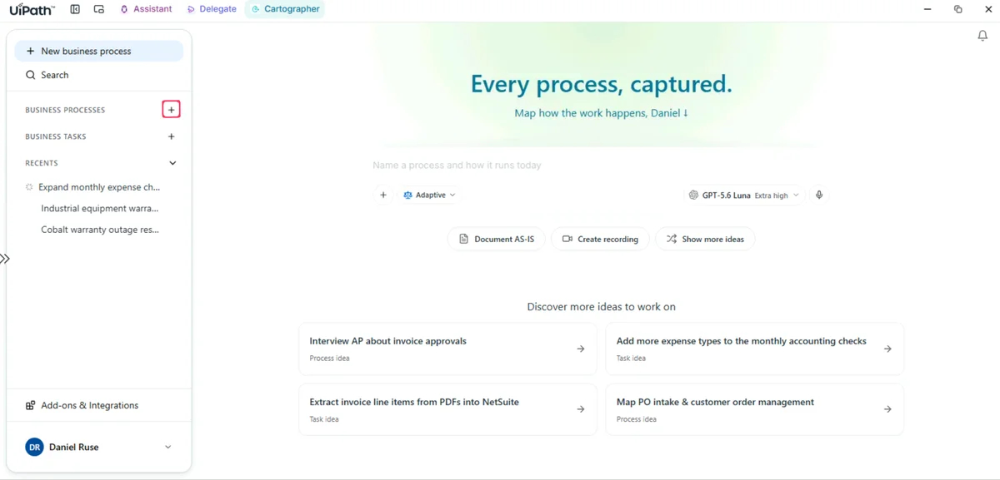
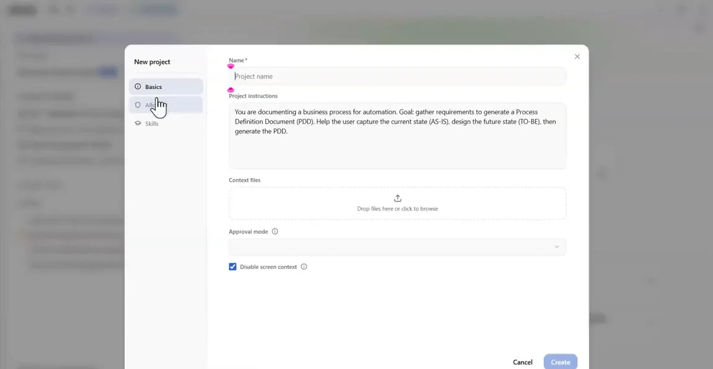
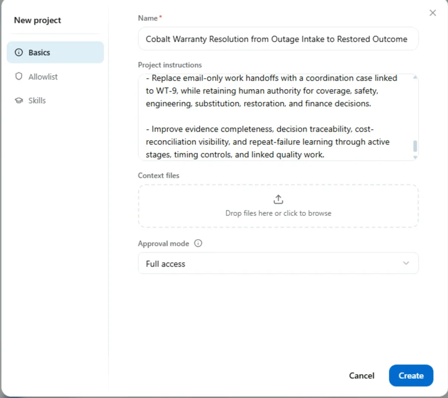
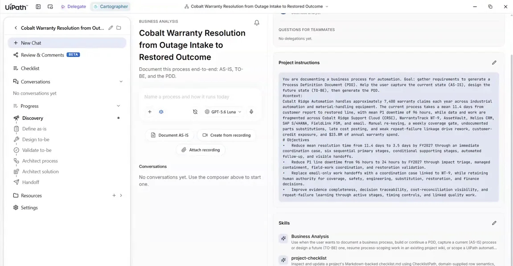
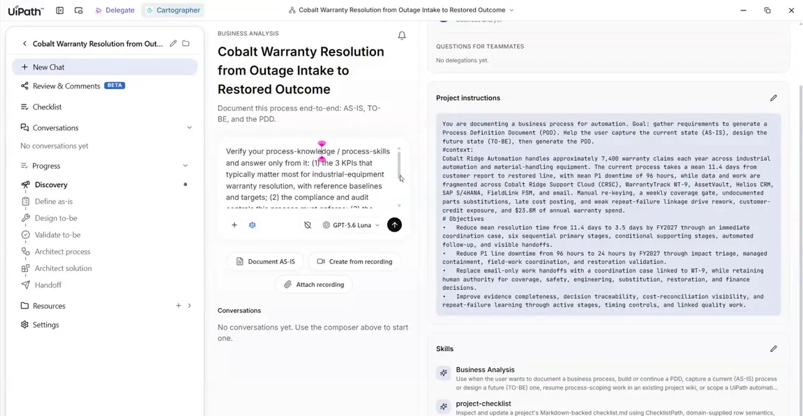
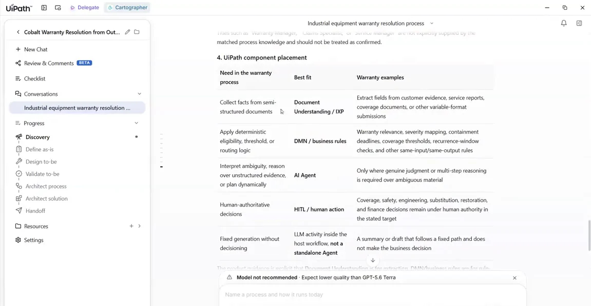

# Set up the project and check its knowledge

## 1. Create the project and give it the brief

1. Open **Cartographer**. On the home screen, click the **+** icon next to **Business Processes** in the left panel.

    { .screenshot width="900" }

2. The **New project** dialog opens. It has a **Name** field and a **Project instructions** box that already contains a generic default paragraph.

    { .screenshot width="900" }

3. In **Name**, type:

    ```text
    Cobalt Warranty Resolution from Outage Intake to Restored Outcome
    ```

4. In **Project instructions**, leave the default paragraph where it is. Paste the brief below straight after it, so the box reads as one continuous set of instructions:

    ```markdown
    #context:
    Cobalt Ridge Automation handles approximately 7,400 warranty claims each year across industrial automation and material-handling equipment. The current process takes a mean 11.4 days from customer report to restored line, with mean P1 downtime of 96 hours, while data and work are fragmented across Cobalt Ridge Support Cloud (CRSC), WarrantyTrack WT-9, AssetVault, Helios CRM, SAP S/4HANA, FieldLink FSM, and email. Manual re-keying, a weekly coverage gate, undocumented parts substitutions, late cost posting, and weak repeat-failure linkage drive rework, customer-credit exposure, and $23.8M of annual warranty spend.

    # Objectives

    - Reduce mean resolution time from 11.4 days to 3.5 days by FY2027 through an immediate coordination case, six sequential primary stages, conditional supporting stages, automated follow-up, and visible handoffs.

    - Reduce P1 line downtime from 96 hours to 24 hours by FY2027 through impact triage, managed containment, field-work coordination, and restoration validation.

    - Replace email-only work handoffs with a coordination case linked to WT-9, while retaining human authority for coverage, safety, engineering, substitution, restoration, and finance decisions.

    - Improve evidence completeness, decision traceability, cost-reconciliation visibility, and repeat-failure learning through active stages, timing controls, and linked quality work.
    ```

5. Check that the dialog now shows your title and the full instructions.

    { .screenshot width="600" }

6. Leave **Context files** empty and **Approval mode** at its default, then click **Create**.

You now have an empty project with no conversations yet. The **Business Analysis** and **project-checklist** skills are listed, and your instructions sit in the right panel.

{ .screenshot width="900" }

## 2. Ask what it already knows, before uploading anything

Don't upload anything yet. Paste this into the composer and send it:

```text
Verify your process-knowledge / process-skills and answer only from it:

(1) the 3 KPIs that typically matter most for industrial-equipment warranty resolution, with reference baselines and targets;

(2) the compliance and audit controls this process must enforce;

(3) the persona titles who run it, by stage;

(4) where UiPath best-practice suggests Document Understanding vs. DMN / business rules vs. AI Agent.
```

{ .screenshot width="900" }

The agent consults its **Process Knowledge** and answers all four parts. You get KPIs with reference baselines plus good and stretch targets, a list of controls, personas by stage, and a component-placement table covering Document Understanding, DMN and business rules, AI agents and human-in-the-loop.

{ .screenshot width="900" }

!!! tip "Why this matters"
    Anything that comes from process knowledge rather than from your own documents is flagged as **not confirmed**. Cartographer never passes off a general industry assumption as one of your facts.

<div class="next-page" markdown>
[Next: Capture and review the AS-IS](capture-as-is.md){ .md-button .md-button--primary }
</div>
